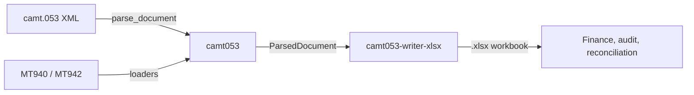

<!-- SPDX-FileCopyrightText: 2026 Sebastien Rousseau <sebastian.rousseau@gmail.com> -->
<!-- SPDX-License-Identifier: Apache-2.0 OR MIT -->

<p align="center">
  
</p>

<h1 align="center">camt053-writer-xlsx</h1>

<p align="center">
  Writes a parsed ISO 20022 camt.053 bank statement to a four-sheet Excel workbook with a stable column layout.
</p>

<p align="center">
  <a href="https://github.com/sebastienrousseau/camt053-writer-xlsx/actions"></a>
  <a href="https://pypi.org/project/camt053-writer-xlsx/"></a>
  <a href="docs/index.md"></a>
  <a href="https://scorecard.dev/viewer/?uri=github.com/sebastienrousseau/camt053-writer-xlsx"></a>
  <a href="LICENSE"></a>
  <a href="https://github.com/sebastienrousseau/camt053-writer-xlsx/blob/main/docs/POLICIES.md"></a>
</p>

<p align="center">
  
</p>

---

## Contents

**Getting started**

- [Install](#install) — `pip`, two runtime dependencies
- [Requirements](#requirements) — toolchain floor, platforms
- [Quick Start](#quick-start) — one call from a camt053 `ParsedDocument` to an `.xlsx` file

**The camt053-writer-xlsx ecosystem**

- [The camt053-writer-xlsx ecosystem](#the-camt053-writer-xlsx-ecosystem) — the six packages of the camt053 suite

**Library reference**

- [Capabilities at a glance](#capabilities-at-a-glance) — the current surface by theme
- [Ecosystem comparison](#ecosystem-comparison) — short matrix; full table at [`docs/COMPARISON.md`](docs/COMPARISON.md)
- [Benchmarks](#benchmarks) — headline numbers; full table at [`docs/BENCHMARKS.md`](docs/BENCHMARKS.md)
- [Features](#features) — module-level capability list
- [Configuration](#configuration) — core options
- [Examples](#examples) — runnable example index

**Operational**

- [When not to use camt053-writer-xlsx](#when-not-to-use-camt053-writer-xlsx) — limitations
- [Development](#development) — make targets, CI
- [Security](#security) — guarantees and compliance
- [Documentation](#documentation) — all reference docs
- [Stability guarantees](#stability-guarantees) — SemVer axis, output stability, minimum toolchain discipline
- [License](#license)

---

## Install

### As a Python library

```sh
pip install camt053-writer-xlsx
```

> **Latest release: v0.0.23**: one `write_xlsx(document, path)` function,
> released in lockstep with the camt053 suite, for Python 3.10+.

The package pulls in [`camt053`][core] (0.0.23 or newer, below 1) and
[`openpyxl`][openpyxl] (3.1 or newer, below 4). There is no command-line
entry point: it is a library.

---

## Requirements

- Python 3.11 or newer, tested in CI on 3.11, 3.12, 3.13 and 3.14 on
  Linux ([toolchain policy](docs/POLICIES.md)).
- `camt053` 0.0.23 or newer on the 0.x line, and `openpyxl` 3.1 or newer on
  the 3.x line.
- Pure Python, so any platform CPython runs on; CI exercises Linux only.

---

## Quick Start

```python
from camt053 import parse_document
from camt053_writer_xlsx import write_xlsx

with open("statement.xml", encoding="utf-8") as fh:
    document = parse_document(fh.read())

write_xlsx(document, "statement.xlsx")
```

`write_xlsx` takes any `camt053.models.ParsedDocument`: the one the camt053
XML parser returns, or the one [`camt053-loader-mt940`][mt940] and
[`camt053-loader-mt942`][mt942] build from SWIFT text. It writes four sheets,
Metadata, Balances, Entries and Reversals, and returns the output path.

---

## The camt053-writer-xlsx ecosystem

This package is one of six in the camt053 suite. They release together at
one version, core first, and share the `camt053.models` data model.

| Component | Purpose | Use case |
| :--- | :--- | :--- |
| [`camt053`][core] | Reads ISO 20022 camt.053, camt.052 and camt.054 statements and generates validated reversing entries | The core library whose `ParsedDocument` this writer takes |
| [`camt053-loader-mt940`][mt940] | SWIFT MT940 customer statements to a camt.053 `ParsedDocument` | A bank, ERP or middleware still emits MT940 |
| [`camt053-loader-mt942`][mt942] | SWIFT MT942 interim transaction reports to a camt.052 `ParsedDocument` | Intraday reports in MT942 |
| **`camt053-writer-xlsx`** | Writes parsed statements to Excel `.xlsx` | Hand a statement to finance as a spreadsheet |
| [`camt053-mcp`][mcp] | MCP server exposing the library to AI agents | Agent workflows over statements |
| [`camt053-lsp`][lsp] | Language server for authoring camt053 reversing-entry data files | Editor support |



---

## Capabilities at a glance

| Area | Capability | Status |
| :--- | :--- | :--- |
| Workbook | Metadata, Balances, Entries and Reversals sheets, bold header row | Supported |
| Entries | One row per `(entry, detail)` pair; an entry without details gets one row | Supported |
| Reversals | Entries with `reversal_indicator=True` or a return reason code | Supported |
| Input | Any `ParsedDocument`: camt.053 XML, MT940 and MT942 via the loaders | Supported |
| Layout | Sheet names and column order fixed across releases | Stable contract |
| Cell types | Amounts and dates written as the strings the model holds | By design; convert in the workbook |
| Formats | `.xls`, `.csv`, encrypted or signed workbooks | Not supported |

---

## Ecosystem comparison

The camt053 core can already export entries: `camt053 entries --export csv`
writes one CSV table. This package writes the whole statement, so the
header, balances and reversals travel with the entries.

| Project | Output | Sheets or tables | Balances and header |
| :--- | :---: | :---: | :---: |
| **camt053-writer-xlsx** | `.xlsx` | Metadata, Balances, Entries, Reversals | Yes |
| `camt053 entries --export csv` 0.0.20 | `.csv` or JSON | One entries table, 8 columns | No |

See [`docs/COMPARISON.md`](docs/COMPARISON.md) for the evidence and complete matrix.

---

## Benchmarks

`benches/bench_write_xlsx.py` writes statements of growing size and reports
time, peak Python heap and file size. The number to read is peak memory:
xlsx is built in memory before anything reaches disk, so peak heap runs
around 60 to 80 times the size of the file written. Nothing asserts a
threshold, because timings are not comparable between machines; CI runs it
with `--quick` so it keeps working against the current API.

| Scenario | Result | Environment |
| :--- | ---: | :--- |
| 1,000 entries | 513.5 ms, 5.09 MB peak, 0.079 MB file | Apple A18 Pro, CPython 3.12.15, shared machine |
| 5,000 entries | 3,987.7 ms, 27.67 MB peak, 0.357 MB file | Apple A18 Pro, CPython 3.12.15, shared machine |
| Peak growth, 100 to 5,000 entries | exponent 0.90 (linear) | same run |

See [`docs/BENCHMARKS.md`](docs/BENCHMARKS.md) for methodology and full results.

---

## Features

- **One function.** `write_xlsx(document, path) -> Path` writes the workbook
  and returns the path it wrote. The file is overwritten if it exists; the
  parent directory must exist.
- **Four sheets, in this order.**

  | Sheet | One row per | Use |
  | :--- | :--- | :--- |
  | Metadata | statement | Message and statement identifiers, account, balance and entry counts |
  | Balances | balance | Type code, amount, currency, credit/debit indicator, date |
  | Entries | `(entry, detail)` pair | Flat, so pivot tables and accounting macros work directly |
  | Reversals | `(entry, detail)` pair of a reversed or returned entry | The auditor's first view |

- **Flat entries.** An entry with N transaction details produces N rows that
  share the entry-level columns, so the sheet stays rectangular.
- **Named columns.** Row 1 of every sheet is a bold header; the full column
  list is in the [user manual](docs/index.md#the-workbook).

---

## Configuration

There are no options. `write_xlsx` takes the document and the output path;
the sheet layout is fixed so that downstream tooling can rely on it.

| Argument | Type | Effect |
| :--- | :--- | :--- |
| `document` | `camt053.models.ParsedDocument` | The statement or report to write |
| `path` | `str` or `pathlib.Path` | Where to write the `.xlsx` file |

---

## Examples

- [`examples/01_minimal_write.py`](examples/01_minimal_write.py): parse a
  camt.053 XML string and write it to Excel.
- [`examples/02_filter_reversals.py`](examples/02_filter_reversals.py): build
  a `ParsedDocument` in code and read back the Reversals sheet.

Both run in CI on every pull request.

---

## When not to use camt053-writer-xlsx

- **You need a custom sheet layout.** The four sheets and their columns are
  fixed by design; fork the writer, or post-process the workbook.
- **You need `.xls` (the legacy binary format).** `openpyxl` writes `.xlsx`
  only.
- **You need encrypted or signed output.** Encrypt the workbook downstream,
  for example with `msoffcrypto-tool`.
- **You want to read Excel back into camt.053.** This package only writes.
- **You need typed numeric and date cells.** Amounts and dates are written as
  the strings the camt053 model holds, so nothing is rounded on the way in;
  convert them in the workbook if you need arithmetic.
- **Memory is tight and statements are large.** The workbook is built in
  memory; size the process from the row count, not the file size
  ([benchmarks](docs/BENCHMARKS.md)).

---

## Development

```bash
git clone https://github.com/sebastienrousseau/camt053-writer-xlsx
cd camt053-writer-xlsx
python -m venv .venv && . .venv/bin/activate
pip install --require-hashes -r requirements/test.txt -r requirements/lint.txt
pip install --no-deps -e .
make check
```

`make check` runs ruff, `reuse lint`, mypy in strict mode, the complexity
ceilings, the version-agreement check, pytest with a 100% line and branch
coverage gate, interrogate at 100% docstring coverage, the benchmark and the
examples. CI also runs the dependency audit (`pip-audit`), Atheris fuzzing
of `write_xlsx` (two minutes per change, thirty weekly), CodeQL, OpenSSF
Scorecard, the DCO check and a daily Suite Consistency check against PyPI.
See [`DEVELOPMENT.md`](DEVELOPMENT.md) and [`CONTRIBUTING.md`](CONTRIBUTING.md).

---

## Security

The writer takes an already-parsed `ParsedDocument`, not raw XML, so the XXE
and entity-expansion surface lives in the `camt053` core. It opens no
sockets and writes only to the path it is given; validating that path is the
caller's job. Releases are published from a signed tag through PyPI Trusted
Publishing, with SLSA build provenance, sigstore signatures and a CycloneDX
SBOM, and every dependency CI installs is hash-pinned and audited with
`pip-audit`.

Report vulnerabilities according to [`SECURITY.md`](SECURITY.md).

---

## Documentation

[User manual](docs/index.md) · [API reference](docs/index.md#the-api) ·
[Developer guide](DEVELOPMENT.md) ·
[Family map](#the-camt053-writer-xlsx-ecosystem) ·
[Changelog](CHANGELOG.md) · [Toolchain policy](docs/POLICIES.md)

---

## Stability guarantees

The project is pre-1.0 and versions advance in `0.0.1` steps, in lockstep
with the camt053 suite. The breaking axis is `write_xlsx`'s signature and the
workbook it writes for a given document: renaming, reordering or removing a
sheet or column, or changing what a cell holds, is breaking even when no
signature moves, and the changelog calls it out. The Python floor moves only
as described in the [toolchain policy](docs/POLICIES.md).

---

## License

This project is dual-licensed under either:

* Apache License, Version 2.0 ([`LICENSE-APACHE`](LICENSE-APACHE) or <https://www.apache.org/licenses/LICENSE-2.0>)
* MIT License ([`LICENSE-MIT`](LICENSE-MIT) or <https://opensource.org/licenses/MIT>)

at your option. Dependencies keep their own licences.

[core]: https://github.com/sebastienrousseau/camt053
[mcp]: https://github.com/sebastienrousseau/camt053-mcp
[lsp]: https://github.com/sebastienrousseau/camt053-lsp
[mt940]: https://github.com/sebastienrousseau/camt053-loader-mt940
[mt942]: https://github.com/sebastienrousseau/camt053-loader-mt942
[openpyxl]: https://openpyxl.readthedocs.io/
